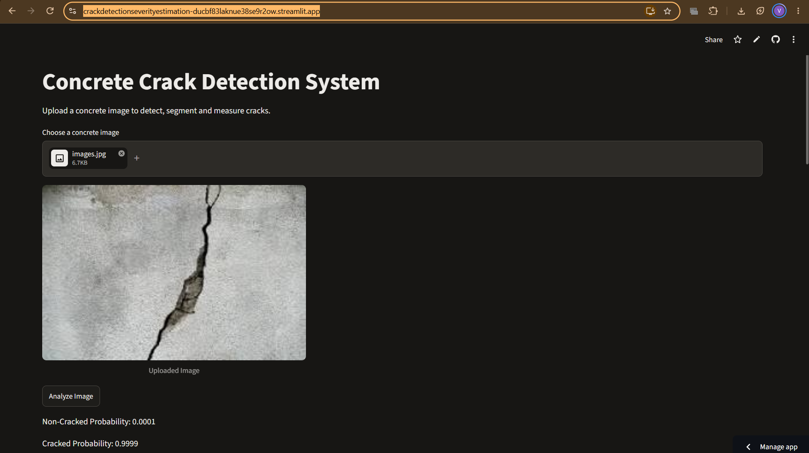
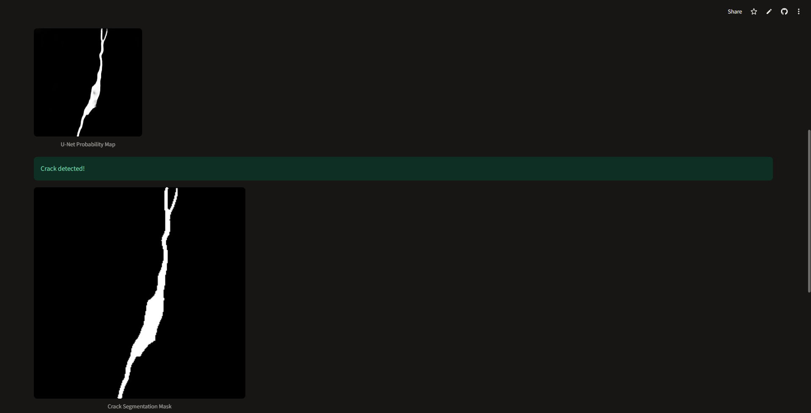
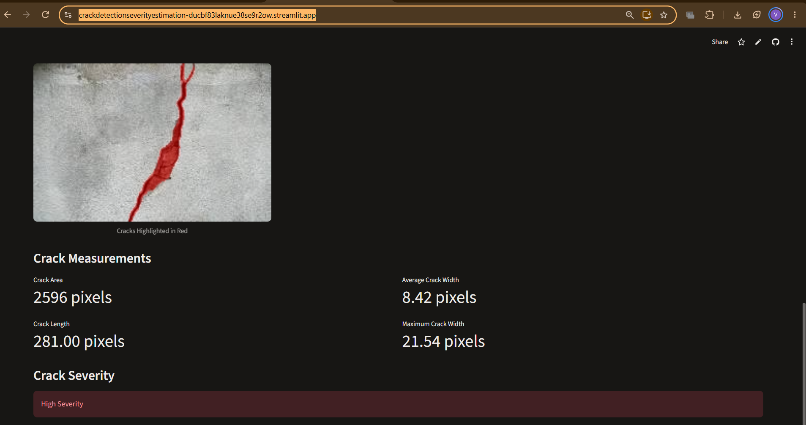

# Surface Crack Detection, Segmentation & Severity Evaluation

[](https://crackdetectionseverityestimation-ducbf83laknue38se9r2ow.streamlit.app/)

A deep learning-based computer vision pipeline and interactive Streamlit web application for automated detection, pixel-level segmentation, and geometric severity assessment of structural surface cracks. Built using PyTorch and trained on multi-source Kaggle surface and structural crack datasets.

🔗 **Live Web App:** [Concrete Crack Detection System on Streamlit](https://crackdetectionseverityestimation-ducbf83laknue38se9r2ow.streamlit.app/)

---

##  Overview

Manual inspection of concrete, masonry, and building surfaces is time-consuming, subjective, and prone to human error. This project provides an end-to-end automated framework—accessible via both Google Colab and a deployed Streamlit web interface—capable of:

1. **Binary Classification:** Distinguishing between `Cracked` and `Non-Cracked` structural surfaces using a custom Convolutional Neural Network (`custom_cnn_crack_model.pth`) with class probability outputs[cite: 6, 7].
2. **Semantic Segmentation:** Generating pixel-level U-Net probability maps and binary segmentation masks (`best_unet_crack_model.pth`) to isolate crack boundaries from complex background textures[cite: 6, 8].
3. **Severity Quantification:** Overlaying detected cracks in red and computing geometric metrics—**Crack Area (px)**, **Crack Length (px)**, **Average Crack Width (px)**, and **Maximum Crack Width (px)**—to classify overall **Crack Severity**[cite: 9].

---

##  Datasets

The training and evaluation pipeline integrates three public Kaggle datasets via `kagglehub`, supplemented by a custom test set of real-world surface photographs:

| Dataset | Kaggle Identifier | Task | Key Contents |
| :--- | :--- | :--- | :--- |
| **Cracked & Non-Cracked Surface** | `geadalfa/cracked-non-cracked-surface-datasets` | Classification | `Cracked` (28,484 images) & `Non Cracked` (67,608 images) |
| **Crack Segmentation Dataset** | `aravindnagarajan/crack-segmentation-dataset` | Segmentation | `train` (9,603 image/mask pairs) & `test` (1,695 image/mask pairs) |
| **Surface Crack Detection** | `arunrk7/surface-crack-detection` | Classification | `Positive` (20,000 images) & `Negative` (20,000 images) |

---

##  Repository Structure

```text
crack_detection_severity_estimation/
├── datasets/                          # Dataset documentation and local/Drive setup instructions
│   └── README.md
├── models/                            # Saved PyTorch model checkpoints (.pth) & model notes
│   ├── best_unet_crack_model.pth
│   ├── custom_cnn_crack_model.pth
│   └── README.md
├── notebooks/                         # Google Colab Jupyter notebook for preprocessing, training & inference
│   ├── Concrete_Crack_Detection.ipynb
│   └── README.md
├── outputs/                           # Generated classification, segmentation masks, and overlay results
│   └── README.md
├── screenshots/                       # Deployed Streamlit web app screenshots
│   ├── streamlit_1.jpg
│   ├── streamlit_2.png
│   ├── streamlit_3.jpg
│   └── README.md
├── .gitattributes                     # Git LFS tracking configuration for model weights
├── .gitignore                         # Ignores temporary files and large dataset archives
├── README.md                          # Main project documentation
├── app.py                             # Streamlit web application for real-time crack inspection
└── requirements.txt                   # Python dependencies
```

---

##  Tech Stack

* **Web Application & Deployment:** Streamlit (`app.py`), Streamlit Community Cloud[cite: 6, 7]
* **Deep Learning Framework:** PyTorch, Torchvision
* **Data Handling & Processing:** NumPy, Pillow (PIL), OpenCV
* **Dataset Management:** `kagglehub`
* **Visualization:** Matplotlib
* **Training Environment:** Google Colab

---

##  Installation & Setup

### 1. Clone the Repository
```bash
git clone [https://github.com/Vaidehigupta05/crack_detection_severity_estimation.git](https://github.com/Vaidehigupta05/crack_detection_severity_estimation.git)
cd crack_detection_severity_estimation
```

### 2. Install Dependencies
```bash
pip install -r requirements.txt
```

### 3. Run the Streamlit App Locally
```bash
streamlit run app.py
```

### 4. Model Training & Colab Execution
1. Open `notebooks/Concrete_Crack_Detection.ipynb` in Google Colab[cite: 6].
2. Mount your Google Drive and configure Kaggle API credentials if required by `kagglehub`.
3. Run the preprocessing, training, and evaluation cells to generate `custom_cnn_crack_model.pth` and `best_unet_crack_model.pth`[cite: 6].

---

##  Methodology & Pipeline

### 1. Data Preprocessing & Class Balancing
* Images are resized, normalized, and augmented to improve generalization across concrete, plaster, and masonry textures.
* Inverse-frequency class weights are applied during training to handle class imbalance across combined surface datasets.

### 2. Two-Stage Detection & Segmentation (`app.py`)
* **Custom CNN Classifier (`custom_cnn_crack_model.pth`):** Evaluates uploaded concrete images to output `Non-Cracked` and `Cracked` probabilities[cite: 6, 7].
* **U-Net Segmentation (`best_unet_crack_model.pth`):** Generates a continuous U-Net probability map and thresholded binary **Crack Segmentation Mask** to isolate exact crack geometry[cite: 6, 8].

### 3. Geometric Severity Quantification
Predicted binary masks are post-processed to highlight cracks in red and compute four structural metrics[cite: 9]:
* **Crack Area (px):** Total foreground segmented pixel count[cite: 9].
* **Crack Length (px):** Skeletonized medial-axis centerline length[cite: 9].
* **Average & Maximum Crack Width (px):** Distance transform measurements across the segmented crack region[cite: 9].
* **Crack Severity:** Automated severity classification (`Low`, `Medium`, or `High Severity`)[cite: 9].

---

##  Deployed Streamlit App Preview

End-to-end inspection workflow on the live [Concrete Crack Detection System](https://crackdetectionseverityestimation-ducbf83laknue38se9r2ow.streamlit.app/):

### 1. Image Upload & Classification Probabilities
*Upload a concrete surface image and run CNN classification (`Non-Cracked Probability: 0.0001` | `Cracked Probability: 0.9999`)*[cite: 7]:

[cite: 7]

### 2. U-Net Probability Map & Binary Segmentation Mask
*Pixel-level probability map and extracted binary segmentation mask confirming crack detection*[cite: 8]:

[cite: 8]

### 3. Crack Overlay, Measurements & Severity Assessment
*Detected crack highlighted in red alongside quantitative measurements (`Area: 2596 px` | `Length: 281.00 px` | `Avg Width: 8.42 px` | `Max Width: 21.54 px`) and **High Severity** classification*[cite: 9]:

[cite: 9]

> *Note: Preliminary inspection assistance only. Does not replace professional structural assessment.*

---

## 👥 Contributors

* **[Vaidehi](https://github.com/Vaidehigupta05)**
* **Shreyas**
* **Vaishnavi**
* **Swanandi**

---

## 📄 License

This project is intended for academic and research purposes. Please refer to the individual Kaggle dataset pages for their respective data usage licenses.
